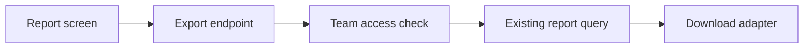

# Weekly report export {#plan}

This is a fictional example of a golden plan. Dates, people and results demonstrate the format.

## Description {#description}

Let team leads download the weekly report they already see on screen. They need to share the same figures with colleagues who do not use the reporting app. The first release covers a single report and a single team at a time.

## Requirements and scope {#requirements}

| Requirement | Acceptance condition |
| --- | --- |
| Match the screen | Exported totals and date range match the selected report. |
| Respect access | A person can export only teams they can view. |
| Be usable elsewhere | The file opens correctly in the team's spreadsheet tools. |

Scheduled delivery, multiple-team exports and historical backfills are outside this task. These are scope statements, not incomplete tasks.

## Architecture {#architecture}

Reuse the report query and permission check. A small export adapter converts the result into a downloadable file; it does not calculate a second set of totals.

Design notes and alternatives

Generating a file in the browser is possible, but it would duplicate formatting logic across clients. The endpoint keeps permissions and serialization in one place.

Report query contract

### Query contract {#query-contract-heading}

The query accepts a team and date range. It returns the same rows used by the screen. No new aggregate store is required.

## Decisions and questions {#decisions}

- [?] Morgan: which file format should the first release support? This determines the download adapter and compatibility checks. {#file-format}

| Option | Benefit | Tradeoff | Position |
| --- | --- | --- | --- |
| CSV | Small file; easy to inspect | Spreadsheet import settings may affect values | Recommended, pending decision |
| XLSX | Preserves types and formatting | Adds a workbook dependency | Alternative |
| Both | Covers more workflows | Doubles format checks for the first release | Alternative |

The format remains undecided. Endpoint permission work can continue independently.

## Risks and dependencies {#risks}

| Risk or dependency | Consequence | Owner and response |
| --- | --- | --- |
| Spreadsheet formula interpretation | A text value could be evaluated as a formula | Riley: test potentially executable cell content before release. |
| Report query contract changes | Export and screen could diverge | Sam: share query fixtures and recheck both consumers. |

## Implementation {#implementation}

### Permission boundary {#permission-boundary}

- [x] Reuse the existing report permission check. Owner: Sam. Complete when denied requests return no report rows. Evidence: the simulated endpoint checks below. {#export-access}
- [~] Connect the shared report query to the endpoint. Owner: Sam. Complete when screen and export fixtures produce identical totals. {#export-query}

### Download adapter {#download-adapter}

- [ ] Implement the selected format. Owner: Riley. Depends on the file-format decision; complete when the compatibility and cell-content checks pass. {#export-format}

Endpoint check details

Fictional observation: an allowed viewer received report rows; a viewer outside the team received an access error and no rows. This verifies the permission boundary only, not the export or its deployed behavior.

## Apply and verify {#apply}

| Target | Version | Apply outcome | Verification | Next action |
| --- | --- | --- | --- | --- |
| Preview | Not built yet | Not applied | Not observed | Build after adapter checks pass. |
| Production | Not selected | Not applied | Not observed | Confirm preview results and recovery procedure. |

- [ ] Verify the preview download in the supported spreadsheet tools. Owner: Riley. Record version, totals, cell behavior and observation date in Results. {#preview-check}

Stop the rollout if permissions, totals or cell handling differ from the acceptance conditions. The recovery procedure is not yet defined; record it before applying a production change.

## Results and evidence {#results}

- Permission boundary checked in the example fixture; a working export is not yet verified. {#now-outcome}
- 2026-10-18, example fixture only; no deployed behavior observed. {#now-verified}

| Criterion | Observation | Evidence and scope |
| --- | --- | --- |
| Respect access | Permission checks passed | [Endpoint check details](#export-access); fictional local fixture, 2026-10-18. |
| Match the screen | Unverified | Shared query connection is still in progress. |
| Be usable elsewhere | Unverified | File format and adapter are pending. |

## Handoff and ownership {#handoff}

- Sam — finish the shared query comparison while Morgan chooses the file format. {#now-next}

Riley can start the adapter after the format decision. Resume from the query fixtures and the decision above; do not interpret the permission result as an accepted release.

## Timeline {#timeline}

| When | Event | Source |
| --- | --- | --- |
| 2026-10-16 | Example task created: export the currently selected weekly report. | Fictional request from Morgan |
| 2026-10-17 | Scope narrowed to one team and one report per download. | Fictional scope discussion |
| 2026-10-18 | Permission checks passed; query comparison started. | Fictional implementation review |

No subsequent application or acceptance is recorded in this example.
